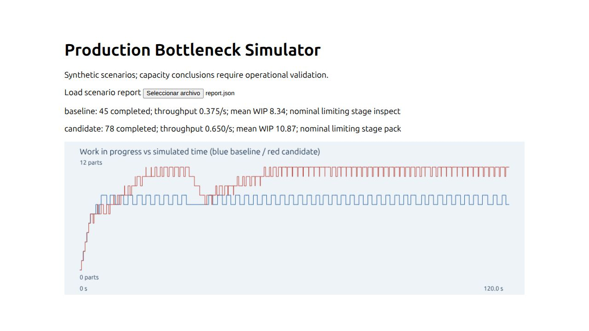

# Production Bottleneck Simulator

Manufacturing planning teams need to see how finite storage and machine capacity affect throughput before changing a line. This Rust discrete-event simulator models identical parts through one machine per stage, finite waiting buffers, blocking after service, scheduled preemptive downtime and bounded seeded cycle-time jitter. Python runs baseline/capacity scenarios; a JavaScript dashboard plots WIP and reports throughput.

## Architecture, requirements and usage

Rust/Cargo, Python 3.12 standard library and Node 18+. Integer millisecond event clock avoids floating event-order ambiguity.

```sh
cargo test --locked
cargo build --locked
python3 src/scenarios.py
python3 -m unittest discover -s tests -v
node --test tests/dashboard.test.js
python3 -m http.server 8080 --bind 127.0.0.1 --directory web
```

Load results/report.json in the dashboard. Synthetic inspection capacity changes from 2500 to 1250 ms/cycle. Three seeds preserve raw config/results; nominal limiting stage shifts from inspect to pack. Actual counts/dispersion are in results/report.md.

## Definitions, assumptions and limits

Buffers count waiting pieces; machine slots are separate. Full downstream buffers block completed work in the upstream machine. Source arrivals drop when its waiting buffer is full. Planned downtime pauses processing; an assigned part can wait inside a down machine. Completion/transfer/dispatch precedes same-time arrivals. Nominal limiting stage has largest cycle adjusted by horizon availability; high utilization alone does not prove an intervention benefit.

Throughput = completed/horizon; WIP is time-integrated queues plus occupied machine slots. Queue waiting averages over started services, lead time over completed pieces; unfinished pieces are censored and reported. Blocked and downtime fractions may overlap. No warmup deletion or steady-state claim. LCG and integer uniform jitter are reproducibility aids, not a validated failure distribution. Maximum 1000 arrivals, eight machines, 100 slots/buffer, 100 downtime intervals/machine and 20000 events. No industrial or physical calibration, staffing, routing, scrap, parallel servers or economic optimization. Portfolio value is explicit event semantics and piece-conservation/analytic checks.

## Verification and publication

Evidence labels: VERIFIED = checked against a stated criterion; OBSERVED = measured execution; INFERRED = interpretation; HYPOTHESIS = proposed explanation; NOT_VERIFIED = missing evidence. Local status and executed commands are in `results/validation.json` and `docs/REVIEW.md`. Synthetic validation establishes implementation behavior, not production accuracy.

This is an independent Git repository with original MIT project code. Publication-gate evidence is in `results/publication-gate-20261012.json` and `docs/PUBLICATION_REVIEW.md`. The original local-delivery records are retained as historical evidence. CI uses public dependency registries and requires no secrets. See `docs/PROVENANCE.md` for dependency and advisory review scope.

## License

MIT; see LICENSE.



## Reproducing development checks

Optional public-registry dependency review: `python3 tools/dependency_audit.py .` writes `results/dependency-audit.json`. This developer check uses the free OSV API and is separate from offline application execution. Zero listed advisories does not prove absence of vulnerabilities. License evidence is in results/licenses.json and, for scientific projects, results/python-licenses.json.

Install `requirements-dev.txt` to run the recorded Ruff 0.17.0 source checks. Commands, actual versions, failed attempts, review corrections and measured peak RSS are retained in results/validation.json, results/tool-versions.json and docs/REVIEW.md. Check the GitHub Actions run for the exact commit before claiming hosted CI success; older local-delivery records retain their as-of NOT_VERIFIED status.
